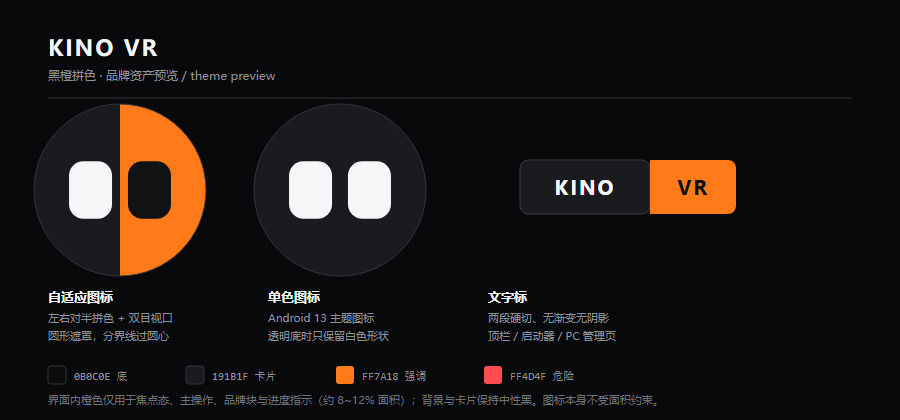
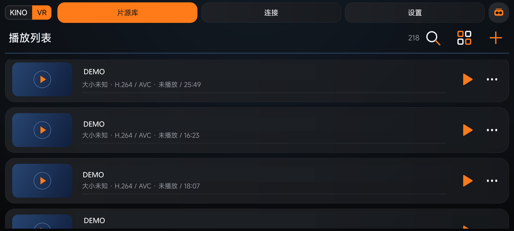
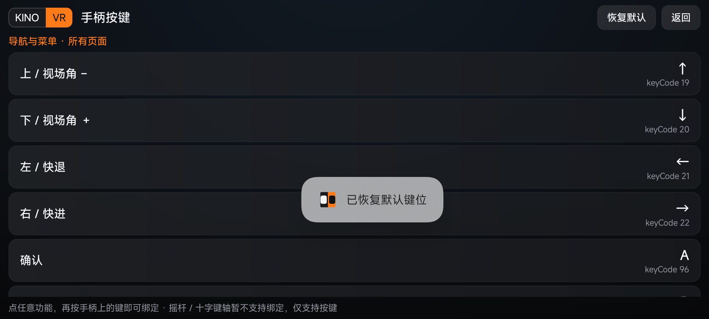
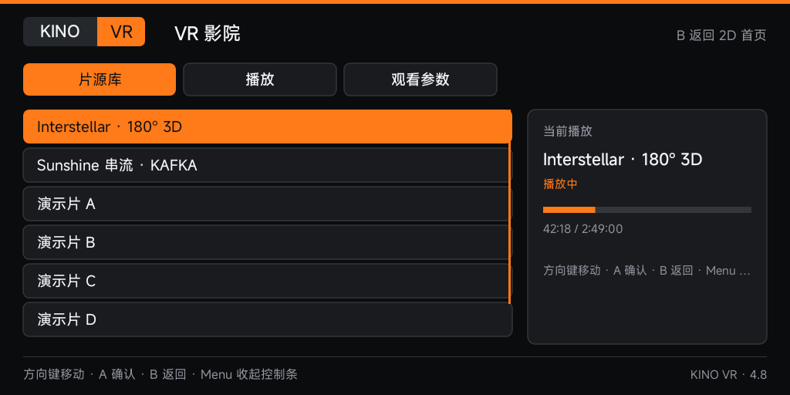
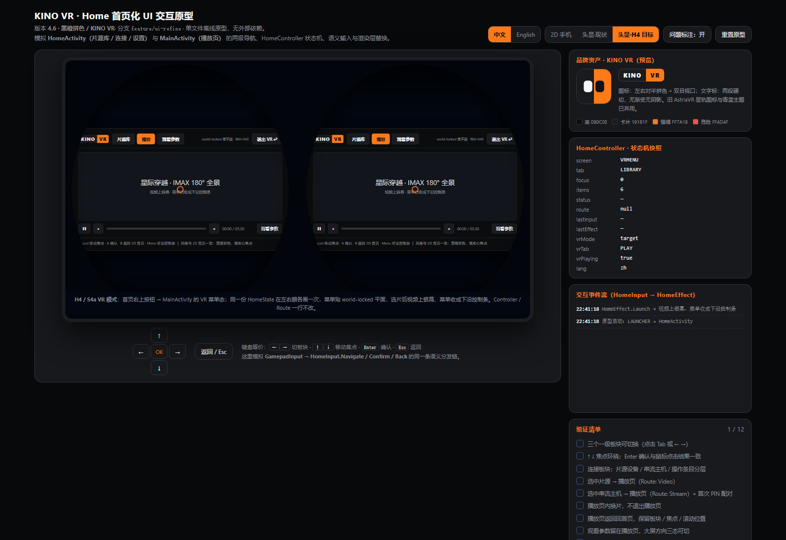

<div align="center">
  
  <h1>KINO VR</h1>
  <p><strong>A binocular VR video player for Android.</strong></p>
  <p>Stereo rendering · Gamepad-first control · PC streaming</p>
  <p>
    <a href="LICENSE"></a>
    
    
    
  </p>
  <p>English · <a href="README.zh-CN.md">简体中文</a></p>
</div>

---

KINO VR turns your phone and a dual-lens VR headset (cardboard-style) into a binocular
video player. It plays local videos and 180°/360° panoramas with stereo layouts,
corrects lens distortion per eye, and streams your PC desktop via
[Sunshine](https://github.com/LizardByte/Sunshine) / Moonlight.

The design goal is simple: **everything can be done from inside the headset with a
gamepad** — browse the library, switch videos, tune optics and adjust playback
without taking the headset off.

## Features

- **Binocular VR rendering** — OpenGL ES 2.0 stereo viewports with per-eye barrel
  distortion correction and circular masks. Adjustable IPD, field of view and lens
  correction; dual-eye vertical alignment (bottom or centered) for headsets with a
  bottom support.
- **Flexible sources** — plain video plus 180°/360° equirectangular panoramas;
  180° fisheye, stereo fisheye, Cubemap 3×2 and EAC projections per viewing mode.
  SBS / top-bottom / mono layouts with automatic detection and manual override.
- **Playlists** — list and grid views, cover thumbnails, sorting, saved playback
  positions. Quick in-headset switching: `← →` step through entries, `↑ ↓` page,
  confirm to play.
- **Gamepad-first navigation** — configurable bindings for 16 actions with a
  capture-style editor; unified key semantics across home, VR menu and playlist.
  HAT / left-stick navigation with diagonal arbitration.
- **In-headset VR menu** — settings, viewing parameters and playlist as a VR overlay;
  the playback controls stay out of the way while the menu is up.
- **Gyroscope head tracking** — on by default, with recentering support.
- **PC streaming** — stream games and desktop from a PC running Sunshine; in-app
  4-digit PIN pairing, local credentials, auto-mute on the phone. An optional
  Windows helper (`pc-server`) proxies the Sunshine PIN flow and manages credentials.
- **English / 简体中文** UI.

## Screenshots

<table>
  <tr>
    <td align="center"><br><sub>Library home</sub></td>
    <td align="center"><br><sub>Gamepad bindings editor</sub></td>
    <td align="center"><br><sub>In-headset VR menu</sub></td>
    <td align="center"><br><sub>Binocular playback</sub></td>
  </tr>
</table>

## Getting started

**Requirements**

- Android 8.0 (API 26) or newer, OpenGL ES 2.0
- A dual-lens VR headset (cardboard-style) for VR viewing
- Gyroscope (optional, for head tracking)
- Bluetooth gamepad (recommended)

**Install**

1. Build the APK from source (see [Building](#building)) — prebuilt binaries are
   not committed to the repo (release APKs may also be published on
   [Releases](../../releases)). Then sideload it. The release package is
   `dev.astriavr.player`; debug builds use `dev.astriavr.player.validation`
   and can coexist.
2. Open the library and add local videos through the system file picker.
3. Pick a viewing mode, projection and video layout for your source — auto-detection
   can be overridden manually.
4. Adjust IPD, field of view and lens correction for your phone + headset combo
   (the alignment grid helps), then insert the phone into the headset.

Playback positions are saved. Natural playback stops at the end of a video rather
than auto-advancing.

**Gamepad basics**

| Input | Action |
| --- | --- |
| Menu / B | Open or close the VR menu, back |
| Start | Open the playlist |
| D-pad / left stick | Navigate |
| A / Enter | Confirm — play the highlighted video |
| `←` `→` (playlist) | Step through entries |
| `↑` `↓` (playlist) | Page up / down |

Bindings are remappable in the app (Settings → gamepad mapping).

## Repository layout

```
kino-vr/
├── astriavr/            Android app (Kotlin/Java, OpenGL ES 2.0, Media3/ExoPlayer)
│   ├── app/             playback, VR rendering, UI, resources, localization
│   ├── tests/           geometry, projection, playback, controller checks
│   ├── scripts/         build, verification and asset scripts
│   └── docs/            build guide and design assets
├── pc-server/           optional Windows helper (Rust): Sunshine PIN proxy,
│                        local credential storage, version-aware input backend
├── docs/architecture/   design notes (branding, navigation, Sunshine embedding)
├── dist/                README screenshots (build artifacts are not committed)
└── ui-prototype.html    offline UI prototype
```

## Building

### Android app

Install JDK 17 or 21 and Android SDK Platform 36 with Build Tools 36.0.0
(AGP 9.0.1, Gradle 9.1.0). `astriavr/toolchain.lock.json` pins the toolchain
downloads with SHA-256 checksums.

```sh
cd astriavr
./gradlew :app:assembleDebug      # Windows: .\gradlew.bat
```

Output: `app/build/outputs/apk/debug/app-debug.apk` (application ID
`dev.astriavr.player.validation`, signed with your local debug key).

Release builds require your own signing credentials in `astriavr/signing.properties`
pointing at a keystore — both are git-ignored and never committed:

```sh
./gradlew :app:assembleRelease
```

See [`astriavr/docs/BUILDING.md`](astriavr/docs/BUILDING.md) for the full build and
verification guide.

### PC server (optional)

Windows, Rust toolchain (`windows-gnu` target), zero third-party runtime dependencies:

```sh
cd pc-server
cargo build --release
```

Output: a single executable. Run it on the streaming PC to manage Sunshine pairing
credentials.

## Privacy & permissions

- Videos are opened through the Android system file picker; the app does not scan
  your storage.
- The **Internet** permission is used only for PC streaming (Sunshine/Moonlight, LAN).
- Playlists, preferences, playback positions and cover caches stay on the device.
  App backup is disabled.
- No accounts, no analytics, no telemetry.

## Contributing

Bug reports and ideas are welcome via [Issues](../../issues). Include the app
version, Android version, device model, viewing mode / projection / layout and the
shortest reproduction steps. Please do not attach private videos, passwords or
signing keys. See [`astriavr/CONTRIBUTING.md`](astriavr/CONTRIBUTING.md).

## Credits

Based on [AstriaVR](https://github.com/AstriaFR) by GitHub [@AstriaFR](https://github.com/AstriaFR).

## License

Licensed under the [GNU General Public License v3.0](LICENSE).
Third-party dependencies retain their own license terms.
