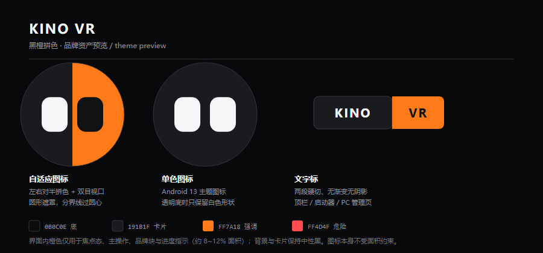
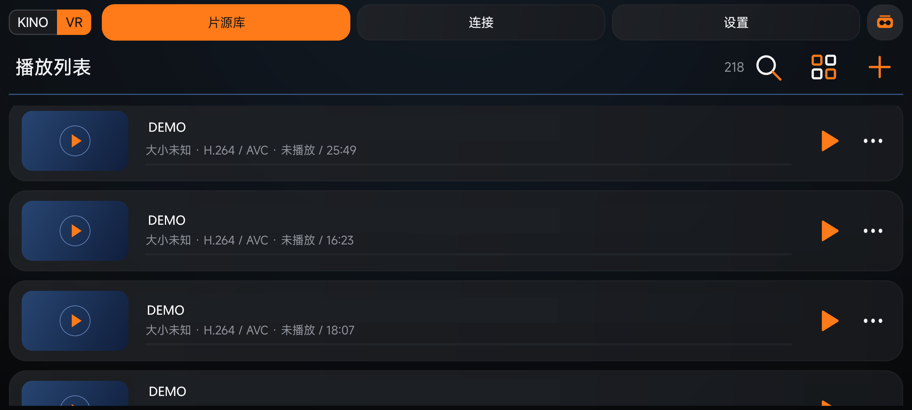
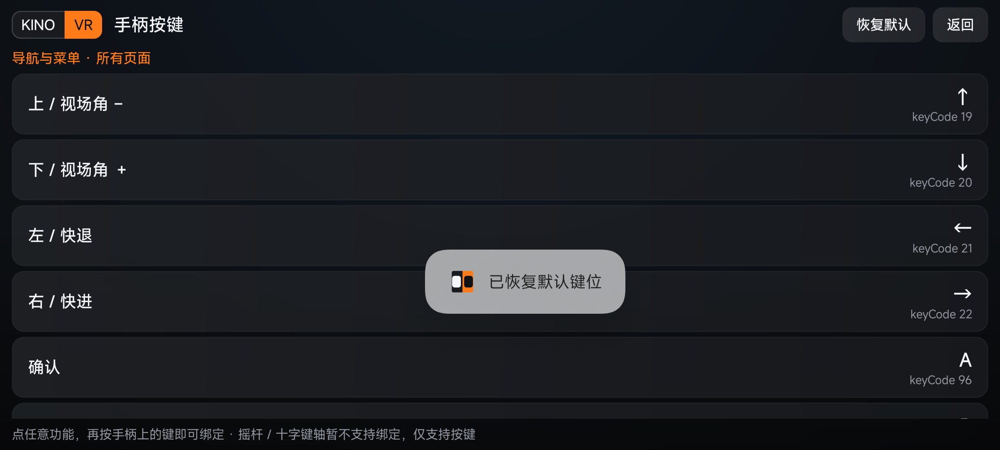
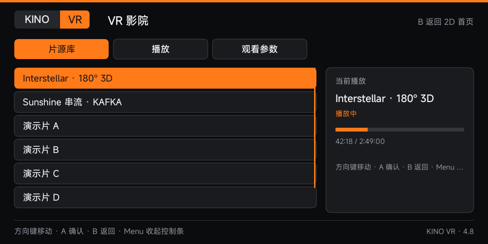
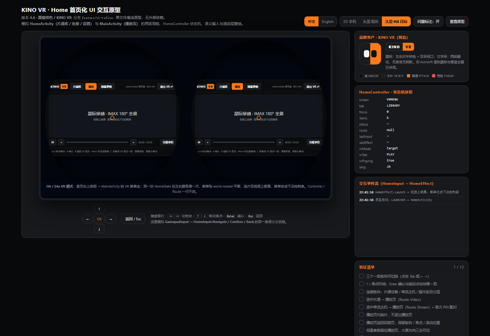

<div align="center">
  
  <h1>KINO VR</h1>
  <p><strong>Android 双目 VR 视频播放器。</strong></p>
  <p>双眼立体渲染 · 手柄优先操控 · PC 串流</p>
  <p>
    <a href="LICENSE"></a>
    
    
    
  </p>
  <p><a href="README.md">English</a> · 简体中文</p>
</div>

---

KINO VR 把手机 + 双镜头 VR 眼镜（纸盒式）变成一台双目视频播放器：本地视频、
180°/360° 全景、立体布局，逐眼校正镜片畸变，还能通过
[Sunshine](https://github.com/LizardByte/Sunshine) / Moonlight 串流电脑画面。

设计目标只有一条：**戴着手柄和头显完成所有操作**——浏览片库、换片、调光学参数、
控制播放，全程不用摘头盔。

## 功能特性

- **双目 VR 渲染** —— OpenGL ES 2.0 双眼视口，逐眼桶形畸变校正与圆形遮罩；
  可调瞳距（IPD）、视场角与镜片补偿；双眼垂直位置可选「吸底 / 上下居中」，
  适配底部有支撑垫高的头戴。
- **丰富的片源** —— 普通平面视频 + 180°/360° 等距柱状全景；按观看模式提供
  180° 鱼眼、立体鱼眼、Cubemap 3×2、EAC 投影。左右分屏（SBS）/ 上下分屏（TB）/
  单画面布局，支持自动识别与手动指定。
- **播放列表** —— 列表 / 网格视图、封面缩略图、排序、播放进度记忆。头显内快速换片：
  `← →` 逐条选片，`↑ ↓` 整页翻，确认播放。
- **手柄优先导航** —— 16 个功能按键可自定义映射（捕获式编辑器）；首页、VR 菜单、
  播放列表统一按键语义；十字键 / 左摇杆导航，斜向自动取主导轴。
- **头显内 VR 菜单** —— 设置、观看参数、播放列表以 VR 浮层呈现；菜单弹出时
  播放控制条自动隐藏。
- **陀螺仪跟头** —— 默认开启，支持重新居中。
- **PC 串流** —— 串流运行 Sunshine 的电脑桌面 / 游戏；应用内 4 位 PIN 配对、
  本地凭据、手机端自动静音。可选的 Windows 辅助工具（`pc-server`）代理
  Sunshine PIN 流程并管理凭据。
- **中英双语**界面。

## 界面预览

<table>
  <tr>
    <td align="center"><br><sub>片库首页</sub></td>
    <td align="center"><br><sub>手柄映射编辑</sub></td>
    <td align="center"><br><sub>头显内 VR 菜单</sub></td>
    <td align="center"><br><sub>双目播放</sub></td>
  </tr>
</table>

## 开始使用

**系统要求**

- Android 8.0（API 26）及以上，OpenGL ES 2.0
- 双镜头 VR 眼镜（纸盒式即可）
- 陀螺仪（可选，用于头部追踪）
- 蓝牙手柄（推荐）

**安装**

1. 自行编译 APK（见[构建](#构建)章节；仓库不附带预编译产物，
   [Releases](../../releases) 可能附带成品包），侧载安装。正式包包名
   `dev.astriavr.player`；调试包为 `dev.astriavr.player.validation`，两者可共存。
2. 打开片库，通过系统文件选择器添加本地视频。
3. 按片源选择观看模式、投影与视频布局——自动识别不准时可手动覆盖。
4. 按手机 + 眼镜组合调整瞳距、视场角与镜片补偿（对齐网格辅助），然后把手机
   放入眼镜。

播放进度会自动记忆；自然播放结束停在片尾，不会自动跳下一条。

**手柄基础操作**

| 按键 | 作用 |
| --- | --- |
| 菜单键 / B | 呼出或收起 VR 菜单、返回 |
| Start | 打开播放列表 |
| 十字键 / 左摇杆 | 导航 |
| A / 确认 | 播放选中的视频 |
| `←` `→`（播放列表） | 逐条选片 |
| `↑` `↓`（播放列表） | 上下翻页 |

按键映射可在应用内改绑（设置 → 手柄映射）。

## 仓库结构

```
kino-vr/
├── astriavr/            Android 应用（Kotlin/Java，OpenGL ES 2.0，Media3/ExoPlayer）
│   ├── app/             播放、VR 渲染、界面、资源、本地化
│   ├── tests/           几何、投影、播放、操控检查
│   ├── scripts/         构建、检查与素材脚本
│   └── docs/            构建说明与设计素材
├── pc-server/           可选 Windows 辅助工具（Rust）：Sunshine PIN 代理、
│                        本地凭据存储、版本感知输入后端
├── docs/architecture/   设计笔记（品牌、导航、Sunshine 嵌入评估）
├── dist/                README 截图（编译产物不入库）
└── ui-prototype.html    离线 UI 原型
```

## 构建

### Android 应用

需要 JDK 17 或 21、Android SDK Platform 36 与 Build Tools 36.0.0
（AGP 9.0.1，Gradle 9.1.0）。`astriavr/toolchain.lock.json` 以 SHA-256 校验和
固定工具链下载版本。

```sh
cd astriavr
./gradlew :app:assembleDebug      # Windows: .\gradlew.bat
```

产物：`app/build/outputs/apk/debug/app-debug.apk`（应用 ID
`dev.astriavr.player.validation`，使用本机调试签名）。

正式构建需要在 `astriavr/signing.properties` 配置自己的签名与 keystore——
两者均已 git-ignore，不会提交：

```sh
./gradlew :app:assembleRelease
```

完整构建与验证流程见 [`astriavr/docs/BUILDING.md`](astriavr/docs/BUILDING.md)。

### PC 辅助工具（可选）

Windows，Rust 工具链（`windows-gnu` 目标），零第三方运行时依赖：

```sh
cd pc-server
cargo build --release
```

产物为单个可执行文件，在串流 PC 上运行即可管理 Sunshine 配对凭据。

## 隐私与权限

- 视频通过系统文件选择器打开，应用不会扫描你的存储。
- **互联网**权限仅用于 PC 串流（Sunshine / Moonlight，局域网）。
- 播放列表、偏好、播放进度与封面缓存全部保存在设备本地；应用备份已关闭。
- 无账号、无广告、无埋点、无数据上传。

## 反馈与贡献

欢迎通过 [Issues](../../issues) 反馈问题与建议。请附应用版本、Android 版本、
设备型号、观看模式 / 投影 / 布局以及最短复现步骤；请勿上传私人视频、密码或
签名密钥。详见 [`astriavr/CONTRIBUTING.md`](astriavr/CONTRIBUTING.md)。

## 署名

基于 [AstriaVR](https://github.com/AstriaFR)（GitHub [@AstriaFR](https://github.com/AstriaFR)）。

## 许可

本项目采用 [GNU 通用公共许可证第 3 版](LICENSE)。第三方依赖仍遵循各自的许可证条款。
